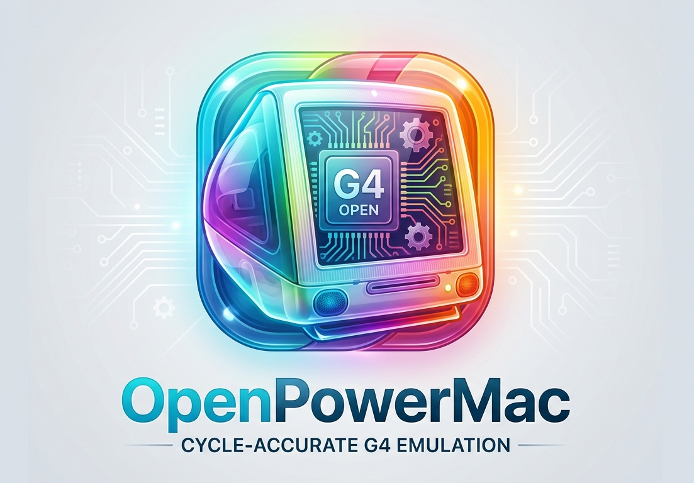

<p align="center">
  
</p>

# OpenPowerMac

A from-scratch Power Macintosh G4 emulator: the Power Mac G4 (AGP Graphics), "Sawtooth",
with its Rage 128 Pro graphics card.

**It installs Mac OS 9 onto a disk it creates, runs it from that disk, and plays the era's 3D
games.** The machine runs Apple's own Open Firmware out of a real Boot ROM image, brings up
the Rage 128 Pro through the card's own ROM, and hands over to Mac OS, which drives the
display, the 2D engine and the 3D engine through its own drivers.

No Apple software is included or distributed. ROMs and operating system media must be
supplied by the user from their own hardware.

## Install (Linux)

Each [release](https://github.com/codingncaffeine/OpenPowerMac/releases) carries:

| | |
|---|---|
| Debian, Ubuntu | `openpowermac_<version>_amd64.deb`: `sudo apt install ./openpowermac_<version>_amd64.deb` |
| Arch | [`openpowermac-bin`](https://aur.archlinux.org/packages/openpowermac-bin) on the AUR |
| Fedora and any other glibc distro | `OpenPowerMac-<version>-linux-x64.tar.gz`: extract it and run `./OpenPowerMac` |
| Alpine and other musl systems | `OpenPowerMac-<version>-linux-musl-x64.tar.gz`: the same |

The packages are self-contained (.NET and SDL3 are inside). The app is an X11 client and
runs through XWayland on Wayland sessions. What to do at the first start, and the few
system libraries the tarballs need, are in the package's
[README.txt](packaging/README.txt).

## What you need

- **The Boot ROM**: the 1 MB image of a Power Mac G4 (AGP Graphics). Firmware 4.2.8f1 and
  3.2.4f1 are both known to boot. A ROM read out of a machine carries that machine's
  system-configuration block alongside the firmware; a ROM assembled from the firmware
  updater carries a template block describing a different board instead, which sends the
  firmware off to wait on hardware this machine does not have. The emulator recognizes that
  case, configures the block as a Sawtooth's before power-on, and says so in the console.
- **The Rage 128 Pro AGP card's ROM.** Without it the machine has no picture.
- **A Mac OS 9 installation CD image.**

## Where it is

| | |
|---|---|
| Processor | a complete MPC7400 (PowerPC G4): integer, floating point, all 162 AltiVec instructions, the hashed-page MMU with BATs, the full exception model |
| Speed | a block translator to x86-64, proved identical to the interpreter by whole-machine fingerprints |
| Open Firmware | boots to the prompt and auto-boots from CD or disk |
| Mac OS 9 | installs from CD onto an emulated disk and runs from it; Restart and Shut Down work |
| Storage | ATA/ATAPI with DBDMA; disks of 20 to 120 GB are created in the app; CDs go in and out while the Mac runs |
| Display | the OS's own driver sets the mode; the desktop is tested at 1024×768 in 256, thousands and millions of colors, through the card's gamma table |
| 2D | the Rage 128's drawing engine: fills, copies, lines, patterns, one-bit sources |
| 3D | the Rage 128's 3D engine at register level, driven by the guest's own driver and drawn on as many threads as the host can spare |
| Input | USB keyboard and mouse, captured from the host |
| Sound | the AWACS codec, played through SDL3 |
| Timing | the guest's clock is paced from the host: a guest second is a real second |
| File exchange | files and folders dropped on the window appear in the Mac on a Drop Box disc with no restart; a host folder can be mounted read-only |
| Mac OS X | does not start yet |

The 3D card is drawn by the processor, so games gain from more host cores. Not modeled:
Sleep, the card's video overlay and scaler, and a few texture formats no manual describes.

Design, methodology, and the provenance ledger live in the
[wiki](https://github.com/codingncaffeine/OpenPowerMac/wiki).

## How it is verified

The CPU core is held to a standard the machine layer is still growing into:

- **SST-PPC** — a single-step test suite authored for this project (no public PowerPC
  equivalent existed): 330 chapters, ~33,000 vectors, byte-identical from MSVC and GCC
  builds.
- **Known-answer tests** — 240 hand-derived vectors covering instruction semantics,
  exception entry state, and the MMU protection matrix.
- **A differential oracle** — the same programs built by a PowerPC cross-compiler and run
  against a host build, compared bit for bit at two optimization levels.
- **Bare-metal proofs** — supervisor and demand-paging kernels whose output must match
  byte for byte.
- **A determinism gate** — floating point is a from-scratch softfloat with no host FP and
  no `fenv`, so results are identical across compilers by construction.

Every hardware behavior the machine relies on is recorded in the wiki's
[Receipts](https://github.com/codingncaffeine/OpenPowerMac/wiki/Clean-Room-Receipts)
ledger with its source tier and how it was verified.

## Building

Requires CMake and a C++20 compiler (GCC and MSVC are both kept green).

### Linux

Needs the .NET 10 SDK for the app, and SDL3 at run time for sound (`sdl3`, `libsdl3-0`).
Built and run on Arch, Debian and Ubuntu (glibc) and on Alpine (musl).

```
tools/build-linux.sh
bin/openpowermac
```

That builds the core, runs its tests, builds the app (`gui/`, Avalonia) and
refreshes the runnable build in `bin/`. Settings live in
`~/.config/OpenPowerMac/shell.json`. Click the screen to capture the mouse and
keyboard; middle-click or Esc gives them back.

On Alpine:

```
apk add build-base cmake samurai dotnet10-sdk bash sdl3 icu-libs fontconfig ttf-dejavu \
        libx11 libice libsm libxi libxfixes libxcursor libxrandr libxext
tools/build-linux.sh
```

`tools/alpine-build.sh` does that build in a throwaway container, runs the core's tests
there and starts the app; CI does the same on every push.

`packaging/build-release.sh` builds the release artifacts (the native libraries in
containers, against glibc 2.28 and in Alpine), and `packaging/release-check.sh` installs
and starts each one in clean Debian, Ubuntu, Fedora and Alpine containers.

### Windows

```
cmake -S . -B build -DCMAKE_BUILD_TYPE=Release
cmake --build build --config Release
ctest --test-dir build -C Release
```

The Windows GUI (`shell/`, WPF on .NET) builds separately once the native
library exists; it picks `opmcapi.dll` up from `shell/native/`:

```
cd shell
dotnet build -c Release
```

The two front ends share the machine session, settings and console code
(`shell/MachineSession.cs` and friends); only the window, input, sound and
dialogs differ. Development moved to Linux, and the releases are Linux packages;
the core and its tests are built and run on Windows by CI on every push.

`tools/g4run` is the machine's command-line front end on both, and carries the
instrumentation used to bring it up. The run scripts in `tools/` find it,
the reference shelf and the install media through `tools/paths.sh`.

`tools/capicheck.py` (Linux) and `tools/capicheck.ps1` (Windows) drive the
library the app runs, the way the app runs it, real-time pacing included,
with no window: the check for anything that works in `g4run` and not in the
app. The Linux one can also hand the guest mouse travel or a key and report
whether the guest took it and whether its cursor moved.

## License

MIT. See [LICENSE](LICENSE); what the release packages carry beside the emulator is in
[THIRD-PARTY-NOTICES.md](THIRD-PARTY-NOTICES.md).
